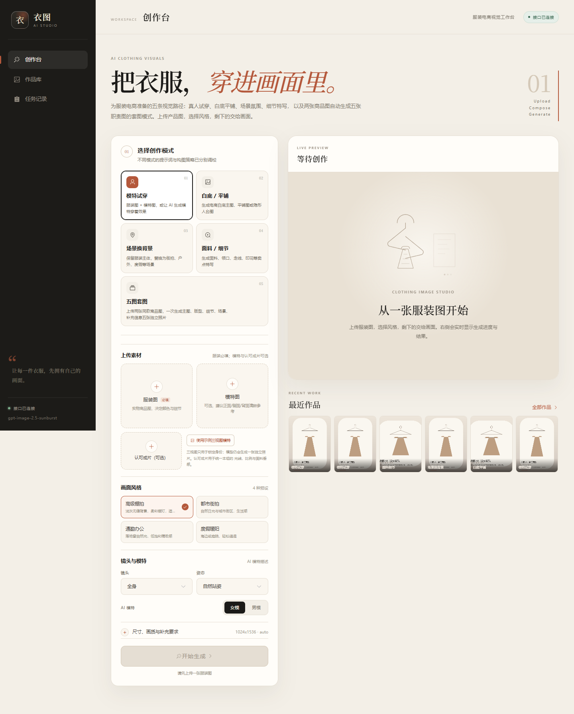
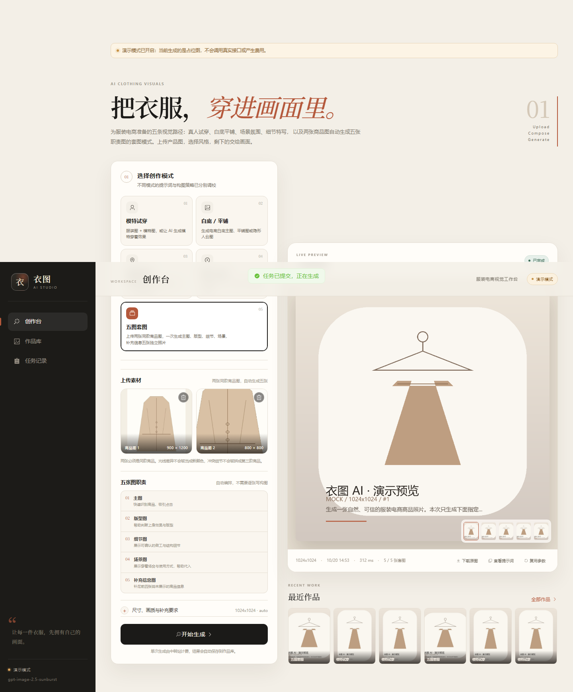
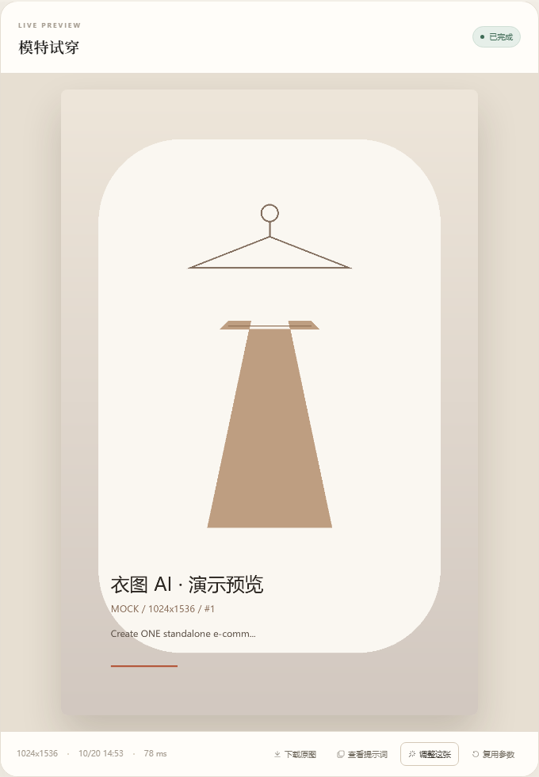

# 衣图 AI · 服装电商生图工作台

面向服装类目的本机 AI 生图工作台：上传服装图，选择试穿、白底/平铺、场景或细节模式，由后端调用中转站的 image2.5 接口生成电商图片，并自动沉淀到作品库。

- 后端：Python 3.12 + FastAPI + SQLAlchemy async + SQLite
- 前端：Vue 3 + TypeScript + Vite + Pinia + Element Plus
- 生图：中转站 `/v1/images/generations` 与 `/v1/images/edits`，兼容 JSON 与 SSE 流式返回
- 部署：本机单用户，无登录/支付，默认只监听 `127.0.0.1`
- 提示词：已接入 `apparel-product-photography` 与 `apparel-two-to-five` 两个 skill 的参考图角色、身份锁定、自然摄影、定向改图和五图套图能力
- 当前状态：已完成五类工作流（含两图生成五图套图）、参考图角色、定向改图、任务队列、作品库、任务记录、下载、复用参数，并通过后端 25 项测试、前端 4 项测试和生产构建

## 界面预览



> 下面是在隔离的 mock 模式服务上生成的界面预览，因此显示了“演示模式”提示；真实接口页面只少了这条黄色提示。





## 功能

### 五类工作流

| 模式 | 输入 | 说明 |
|---|---|---|
| 模特试穿 | 服装图（必填）+ 模特图 + 认可成片（均可选） | 有模特图时锁定脸型、发型、肤色和身材；认可成片用于统一光线、比例和面料垂感；无模特图时按性别/镜头/姿态生成 AI 模特 |
| 白底 / 平铺 | 服装图（必填） | 纯白底、浅灰底、平铺图、隐形人台，可指定正/背面 |
| 场景换背景 | 服装图（必填） | 都市街拍、自然户外、度假海边、极简室内、高级灰棚 |
| 面料 / 细节 | 服装图（必填） | 面料、领口、袖口、走线、印花、拉链五金 |
| 五图套图 | 恰好两张同款商品图 | 自动生成主图、版型图、细节图、场景图、补充信息图；首张成片作为后续四张的人物与系列一致性参考 |

单图模式使用从 `apparel-product-photography` skill 适配而来的英文提示词；五图套图使用从 `apparel-two-to-five` 适配的中文单图模板。两者都内置商品保真、自然摄影与瑕疵规避约束。

### 五图套图（two-to-five）

- 输入恰好两张同款商品图，不要求上传模特图，也不要求逐张写构图。
- 固定五种职责：
  1. **主图**：正面或轻微转角全身上身，干净浅色背景，快速识别商品。
  2. **版型图**：同模特 45–70° 侧前方，展示肩线、松紧、长度和垂感。
  3. **细节图**：原图中可确认的领口、门襟、口袋或图案结构近景。
  4. **场景图**：按商品用途选择可信生活场景，自然动作，商品仍是主体。
  5. **补充信息图**：有真实背面证据时拍背面；否则选一个与第 3 张不重复的已知部位。
- 先生成第 1 张；检查后把它作为内部 anchor，与两张原始商品图一起传给第 2–5 张，避免逐张累积漂移。
- 每张独立生成，不拼图；每张仍只发送当前职责的提示词。
- 中间某张失败时，已完成图片会保留，任务标记失败；可以整组重试，但不支持单张定向改图。
- 进度以 `shots_done / shots_total` 持久化，页面轮询显示“正在生成第 N / 5 张”。
- 五图套图会产生 **5 次独立生图调用**，请留意中转站费用。

### 参考图角色与定向改图

- **Image 1 — 服装实物**：决定颜色、版型、领口、纽扣、口袋、图案和现有标识；冲突时以实物图为准。
- **Image 2 — 模特身份**：锁定脸型、五官、体型、肤色和发型。三视图/多面板参考只用于身份证据，输出仍然是单张照片。
- **Image 3 — 认可成片**：提供已认可的摄影质感、穿着比例和面料垂感，不覆盖实物细节。
- **改图对象**：对已完成作品点“调整这张”，输入具体问题（站姿、手指、皮肤、光线、褶皱等），系统会把当前结果作为 EDIT TARGET，同时继续携带原始服装图和模特参考重新拍摄。
- 建议每张图最多做两轮定向调整；两轮后仍有商品结构或身份一致性问题的，回到创作台重新生成。
- 页面可一键载入内置的示例三视图模特。

### 其他能力

- 图片上传校验：JPG/PNG/WebP、≤15 MB、EXIF 转正、sRGB、长边 3072px、自动缩略图
- 单任务最多 4 张参考图；任务串行执行，避免触发限流
- 实时任务状态：排队 → 生成 → 成功/失败，轮询不阻塞页面切换
- 服务重启恢复：running 任务标记失败，queued 任务自动重新入队
- 失败任务可重试；排队任务可取消；成功任务可复用参数
- 五图套图串行生成、逐张落库；失败时保留已完成图片
- 定向改图保留 `parent_job_id` 血缘，任务详情会显示“定向改图”和改图对象
- 作品库按模式筛选（含五图套图），支持大图查看、下载、复用
- 无 API Key 时页面可正常查看；`IMAGE_MOCK=true` 时使用占位图演示完整流程
- 生产构建后 FastAPI 可直接托管前端，单地址访问

## 目录

```
picture/
├─ backend/
│  ├─ app/
│  │  ├─ main.py              # FastAPI、生命周期、异常、静态前端
│  │  ├─ config.py            # 根目录 .env
│  │  ├─ db.py / models.py / schemas.py
│  │  ├─ api/                 # meta / assets / jobs / gallery
│  │  └─ services/            # storage / images / prompts / relay / runner
│  ├─ tests/
│  └─ requirements*.txt
├─ frontend/
│  ├─ src/
│  │  ├─ api/client.ts
│  │  ├─ components/
│  │  ├─ layouts/AppShell.vue
│  │  ├─ stores/
│  │  ├─ views/StudioView.vue / GalleryView.vue / JobsView.vue
│  │  └─ styles/main.css
│  └─ package.json
├─ data/                      # 运行时生成：数据库、上传图、输出图、缩略图
├─ samples/                   # 可选测试图
├─ scripts/
├─ .env                       # 本机配置（不提交）
├─ .env.example
├─ start-dev.cmd
└─ README.md
```

## 快速开始

### 1. 环境

本机已按以下版本验证：

- Windows 10/11
- Python 3.12.10
- Node.js 24、npm 11

当前 Windows PowerShell 禁止执行 `.ps1` 脚本，因此下文统一使用 `npm.cmd`，不要使用 `npm`。

如果从空环境开始安装 Python 3.12：

```powershell
winget install --id Python.Python.3.12 --exact --scope user --silent `
  --accept-package-agreements --accept-source-agreements --disable-interactivity
```

### 2. 后端依赖

```powershell
cd E:\project\picture
C:\Users\<你的用户名>\AppData\Local\Programs\Python\Python312\python.exe -m venv backend\.venv
backend\.venv\Scripts\python.exe -m pip install -r backend\requirements-dev.txt
```

### 3. 前端依赖

```powershell
cd E:\project\picture\frontend
npm.cmd install
```

### 4. 配置生图接口

编辑根目录 `.env`：

```env
IMAGE_API_BASE=https://你的中转站域名/v1
IMAGE_API_KEY=你的密钥
IMAGE_MODEL=image2.5 的实际模型 ID
IMAGE_MOCK=false
```

说明：

- `IMAGE_API_BASE` 填写到 `/v1` 为止，后端只会追加 `/images/generations` 或 `/images/edits`。
- `IMAGE_MODEL` 按你的中转站实际模型 ID 填写；本机当前配置的是 `gpt-image-2.5-sunburst`，以页面侧栏显示的模型名为准。
- 密钥只存在后端环境变量中，不会返回给前端、不会写进日志、不会提交到仓库。
- 本机 `.env` 已配置真实接口。需要不花钱地演示或跑 UI 测试时，请用 `IMAGE_MOCK=true` 启动一个隔离数据目录的测试服务，不要直接对真实服务点生成。

### 5. 启动开发环境

方式一：双击根目录 `start-dev.cmd`，会打开两个命令行窗口。

方式二：手动两个终端：

```powershell
# 终端 1
cd E:\project\picture\backend
.\.venv\Scripts\python.exe -m uvicorn app.main:app --reload --port 8000
```

```powershell
# 终端 2
cd E:\project\picture\frontend
npm.cmd run dev
```

- 前端：<http://127.0.0.1:5173>
- 后端 API 文档：<http://127.0.0.1:8000/api/docs>
- 健康检查：<http://127.0.0.1:8000/api/health>

### 6. 生产构建 + 单地址运行

```powershell
cd E:\project\picture\frontend
npm.cmd run build
cd ..\backend
.\.venv\Scripts\python.exe -m uvicorn app.main:app --host 127.0.0.1 --port 8000
```

打开 <http://127.0.0.1:8000>。FastAPI 会在检测到 `frontend/dist` 后自动托管前端。

## 配置项

| 变量 | 默认值 | 说明 |
|---|---|---|
| `IMAGE_API_BASE` | `https://api.apikey.fan/v1` | 中转站接口前缀，含 `/v1` |
| `IMAGE_API_KEY` | 空 | 只放在后端 .env |
| `IMAGE_MODEL` | `gpt-image-2` | 改为你的 image2.5 模型 ID |
| `IMAGE_TIMEOUT_SECONDS` | `900` | 单次生图读取超时 |
| `IMAGE_WORKERS` | `1` | 后台并发数，限制在 1–4 |
| `IMAGE_MOCK` | `false` | 本地演示模式，生成占位图 |
| `APP_HOST` / `APP_PORT` | `127.0.0.1` / `8000` | 后端监听地址 |
| `APP_DATA_DIR` | `./data` | SQLite、上传图、输出图目录 |
| `CORS_ORIGINS` | 本地 Vite 地址 | 开发跨域白名单 |
| `SERVE_FRONTEND` | `true` | 存在 dist 时托管前端 |

## 接口协议

后端使用你给出的中转站协议：

- 文生图：`POST {IMAGE_API_BASE}/images/generations`，JSON
- 图生图/编辑：`POST {IMAGE_API_BASE}/images/edits`，multipart，字段 `image` 可重复
- 固定参数：`model`、`prompt`、`n=1`、`size`、`quality`、`stream=true`、`response_format=b64_json`
- 请求头：`Authorization: Bearer <key>`、`Accept: text/event-stream`
- 支持 JSON 与 SSE 响应；自动解析根级或 `data[0].b64_json`
- 提示词按 skill 结构输出英文；用户补充要求和改图反馈保留原文
- 参考图按“服装 → 模特身份 → 认可成片 → 补充参考 → 改图对象”排序，提示词编号与附件顺序一致
- 不抓取上游返回的 URL，避免 SSRF；只接受 b64 图片
- 生成请求不自动重试，避免重复扣费

单图四类工作流都至少需要一张服装图，五图套图固定需要两张；实际主要走 `/images/edits`。`/images/generations` 已完整封装，供后续增加纯文生图模式。

### 业务 API

| 方法 | 路径 | 说明 |
|---|---|---|
| GET | `/api/config` | 模型、是否已配置、是否 mock |
| GET | `/api/meta` | 工作流、风格、尺寸、画质、提示词选项 |
| GET | `/api/health` | 服务状态 |
| POST | `/api/assets` | 上传素材 |
| GET | `/api/assets/{id}/content` | 原图/缩略图/下载 |
| DELETE | `/api/assets/{id}` | 删除未被引用的上传图 |
| POST | `/api/jobs` | 创建生成任务 |
| GET | `/api/jobs` | 任务分页与筛选 |
| GET | `/api/jobs/{id}` | 任务详情 |
| POST | `/api/jobs/{id}/cancel` | 取消排队任务 |
| POST | `/api/jobs/{id}/retry` | 复制参数创建新任务 |
| POST | `/api/jobs/{id}/revise` | 以结果为改图对象，带反馈定向重拍 |
| GET | `/api/gallery` | 成功作品分页 |

## 测试

```powershell
cd E:\project\picture\backend
.\.venv\Scripts\python.exe -m pytest -q

cd ..\frontend
npm.cmd run typecheck
npm.cmd test
npm.cmd run build
```

当前后端 25 项测试覆盖：

- 提示词模板、风格、角色校验
- 上传图片校验、EXIF/格式处理、缩略图、mock 图
- 中转站 JSON/SSE 解析、401 映射、无图错误
- 素材上传/读取/下载/删除保护
- 任务创建、mock 全流程、作品库、重试、失败输入、取消终态校验
- 参考图角色、approved 与 edit_target、定向改图 API 与父子任务
- 五图套图五张 Prompt、shots_total/shots_done、五张输出与作品库
- 服务重启后的 running/queued 恢复逻辑

前端测试与 UI 走查：

```powershell
cd E:\project\picture\frontend
npm.cmd test
npm.cmd run typecheck
```

由于本机 `.env` 已配置真实接口，UI 冒烟必须用隔离的 mock 服务，避免消耗真实额度：

```powershell
# 终端 A：mock 服务，独立数据目录，监听 8001
cd E:\project\picture\backend
$env:IMAGE_MOCK='true'
$env:APP_DATA_DIR='E:\project\picture\data-ui-smoke'
.\.venv\Scripts\python.exe -m uvicorn app.main:app --host 127.0.0.1 --port 8001

# 终端 B：跑 UI 冒烟（脚本默认连接 8001，并会拒绝 mock=false 的地址）
cd E:\project\picture\frontend
npm.cmd run ui:smoke
```

`ui:smoke` 使用本机 Chrome/Edge 无头模式走查：五个工作流切换、示例三视图模特、上传、单图生成、定向改图、五图套图（两张商品图 → 5 张输出）、提示词弹窗、作品库详情、复用参数、任务详情、移动端布局，并把截图保存到 `screenshots/`。

只检查真实服务页面是否可加载、不触发生成：

```powershell
cd E:\project\picture\frontend
npm.cmd run ui:load
```

### 真实接口冒烟

配置好真实 Key 且 `IMAGE_MOCK=false` 后：

```powershell
cd E:\project\picture
backend\.venv\Scripts\python.exe scripts\real_api_smoke.py
```

脚本会明确提示可能产生一次真实费用，需要输入 `YES` 确认，并把结果保存到 `data/smoke/`。

### 没有素材时

```powershell
backend\.venv\Scripts\python.exe scripts\create_sample_images.py
```

会生成 `samples/garment.png`、`samples/garment-detail.png` 与 `samples/model.png`。`samples/model-triptych.png` 是内置示例三视图模特，也可以在页面上点“使用示例三视图模特”直接载入；五图套图可用 garment 与 garment-detail 作为两张同款商品图。

## 数据与备份

运行时数据都在 `data/`：

```
data/
├─ app.db                 # 任务与素材元数据
├─ uploads/YYYY/MM/       # 上传原图
├─ outputs/YYYY/MM/       # 生成结果
└─ thumbs/YYYY/MM/        # 缩略图
```

备份时停止服务，复制整个 `data/` 目录即可。首版不做自动清理；删除上传素材前，系统会检查是否被任务引用。

## 安全边界

- 首版**没有登录鉴权**，默认只绑定 `127.0.0.1`，适合本机自用。
- 不要把 `APP_HOST` 改成 `0.0.0.0` 后直接暴露公网；如果必须局域网/公网访问，请先加反向代理认证与 HTTPS。
- `.env`、`data/` 已在 `.gitignore` 中。
- 接口密钥只由后端读取；`/api/config` 返回的 base URL 会去掉用户信息与查询串。
- 上传图片会经过 Pillow 校验和重编码，拒绝伪造扩展名、损坏文件和超大像素图。
- 上游返回只接受 b64 图片，不下载任意 URL。

## 常见问题

### PowerShell 报 “npm.ps1 cannot be loaded”

系统执行策略限制。使用 `npm.cmd` 代替 `npm`。

### `python` 命令打开 Microsoft Store / 提示未安装

PATH 里的是 WindowsApps 别名。请使用完整路径：

```text
C:\Users\<用户名>\AppData\Local\Programs\Python\Python312\python.exe
```

或在“设置 → 应用执行别名”中关闭 Python 的商店别名。

### 页面显示“还差一步：配置生图接口”

编辑根目录 `.env`，填写 `IMAGE_API_KEY`，并确认 `IMAGE_MOCK=false`，重启后端。

### 页面显示“演示模式”

`IMAGE_MOCK=true`。当前生成的是占位图。改成 `false` 并配置 Key 后重启。

### 生成失败但余额正常

- 检查 `IMAGE_MODEL` 是否是中转站里的 image2.5 实际模型 ID
- 先尝试画质 `auto`；部分 Gemini 分组不支持 `low/medium/high`
- 查看任务记录中的错误码和上游返回摘要
- 若中转站要求 `size` 为特定值，可先使用 `1024x1024`

### 端口被占用

后端改端口时同步修改 `frontend/vite.config.ts` 中的代理目标，或关闭占用 8000/5173 的进程。

## 已知边界

- 单用户、本机、单进程 SQLite，不支持多机分布式队列
- 不做批量任务、海报文字排版、支付、额度、账号体系
- 不做视频、LoRA、模特训练、蒙版局部重绘
- 图片生成质量最终取决于中转站模型与提示词；提示词模板可继续按你的品类调整
- 首版任务队列是进程内 asyncio 队列，重启时 running 任务会标记失败，queued 会恢复
- 五图套图内部仍是 5 次独立调用、5 张独立图片；不做拼图
- 五图套图暂不支持单张定向改图；某张失败时只保留已完成图片并整组重试
- 定向改图最多建议两轮，系统不硬性阻止第三轮，但会在界面提示
- 商品细节的视觉一致性仍需人工对照实物图确认，提示词本身不保证绝对还原
